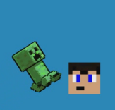
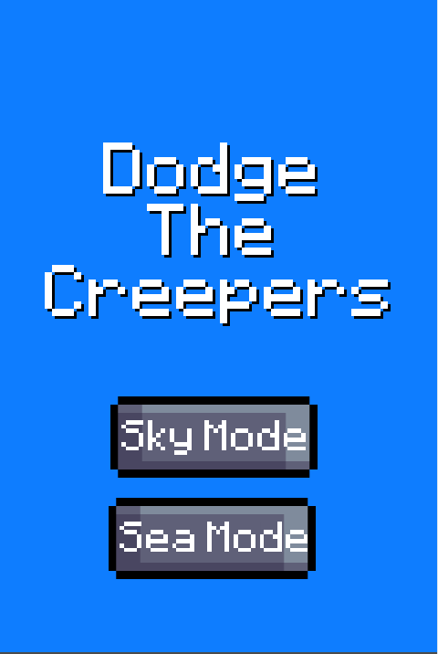
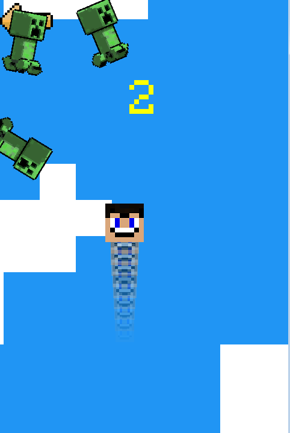
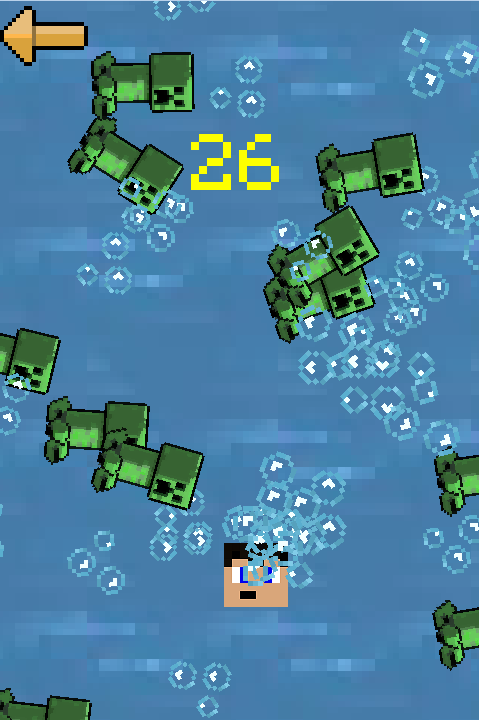

# Dodge-the-creepers!!!

这是一款基于官方Godot 3.5“你的第一个2D游戏”教程制作的2D躲避游戏。这个项目的主要目的是学习Godot引擎的基础知识。

是2022年SkyShadowHero中考假时学习并修改，代码很乱没有学习价值。
2025年终于会放源码了

一个灵感来自《我的世界》的迷你游戏，只需移动来躲避苦力怕即可。  

你可以使用[W][A][S][D]、[↑][←][↓][→]或触摸屏幕按钮来移动。  

这只是一个不怎么有趣的游戏，所以玩得开心！！！  

这个游戏非常容易上手，即使你什么都不知道！

---

### 游戏截图

  
  
  

